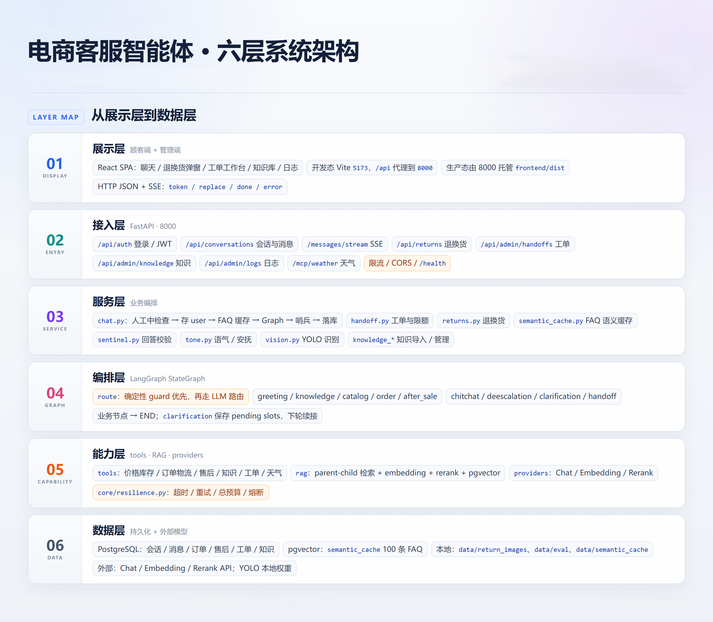
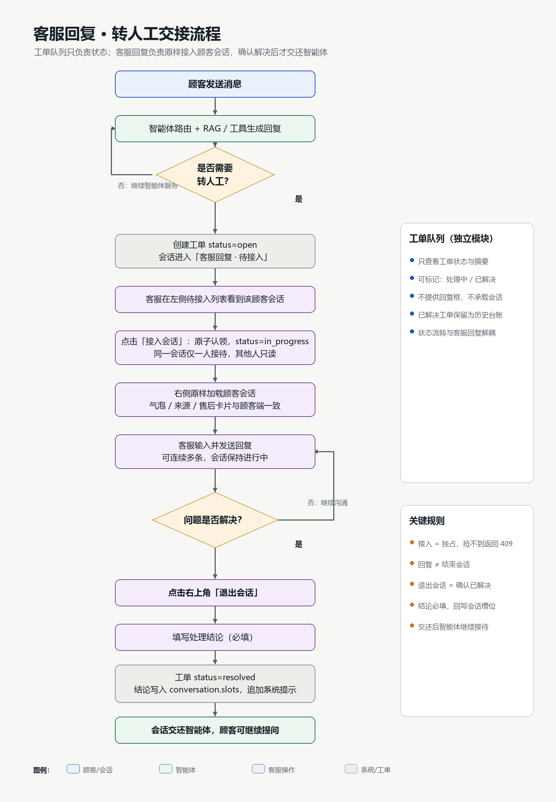

# 电商智能客服系统

一套面向电商咨询与售后场景的智能客服系统。以「静态知识检索 + 动态数据查询」双引擎为核心，
采用父子块分层 RAG 架构，基于 LangGraph 完成意图路由、工具调用与回答生成；同时支持人工接管、
拍照退换货、流式输出、回答校验和异常兜底。

> 运行、配置、测试与部署说明见 [运行与配置](docs/运行与配置.md)。

## 系统组成

- **顾客端** `/app`：登录、多轮对话、来源溯源、订单卡片、退货卡片、转人工。
- **管理端** `/admin`：工单队列、客服回复工作台、知识库、运行日志与退换货证据。
- **服务端**：FastAPI 提供 REST 与 SSE；LangGraph 负责对话编排；PostgreSQL + PGVector 保存业务数据、知识切片与 FAQ 缓存。
- **模型侧**：OpenAI 兼容对话模型、DashScope Embedding / Rerank、本地 YOLO 视觉识别；默认使用内置 Mock 模型，可以支持离线演示。

## 系统架构

系统按调用顺序分为六层：

- **展示层**：React SPA，顾客端与管理端共用一套 API。
- **接入层**：HTTP / SSE 接口、JWT、限流、CORS、静态页面托管与健康检查。
- **服务层**：对话编排、工单、退换货、FAQ 缓存、哨兵、语气与知识管理。
- **编排层**：LangGraph 状态图；确定性 guard 优先，未命中再走 LLM 意图路由。
- **能力层**：只读工具、父子块 RAG、Chat / Embedding / Rerank Provider，以及统一超时、重试、预算与熔断。
- **数据层**：PostgreSQL 业务数据、PGVector 检索与缓存、本地图片 / 评测资产、外部模型 API。

## 核心能力

### 静态知识与动态事实

- 商品规则、退换政策等静态知识走父子块 RAG：子块召回、父块补上下文，回答带来源。
- 价格、库存、订单、物流、售后进度等动态事实走 SQL 或只读工具，不进入静态知识检索。
- 知识不足时创建 `knowledge_gap` 工单，顾客收到安全提示，不阻断会话。

### 对话编排与上下文工程

- 确定性 guard 优先处理问候、显式转人工、投诉、纯情绪、售后与槽位续接，避免误判。
- `clarification` 节点保存待补槽位；下一轮补订单号或商品名后继续原意图。
- `CONTEXT_ENGINE_ENABLED=1` 时，回答、路由、工具规划和闲聊 Prompt 共用统一 Context Pack，按预算组装系统规则、槽位、工具事实和历史窗口。
- `FC_READONLY_ENABLED=1` 时，订单与物流意图可调用 `order_list`、`order_detail`；规划器不能传 `user_id`，写操作永不进入 FC。

### 流式输出与回答校验

- 回答通过 SSE 输出 `token / replace / done`，并用心跳保持连接。
- 知识回答先完整缓冲并校验，避免先吐半截再被固定话术覆盖。
- 流式首 token 前失败可重试；已出 token 后失败转为非流式重生成，并用 `replace` 整体覆盖气泡。
- 异步哨兵在落库前检查事实依据与政策承诺；超时、异常或 JSON 非法时 fail-open，判定违规时替换为保守话术。

### 人工接管与工单

- 投诉、显式转人工、知识缺口和工具异常都可以创建工单；同一用户跨会话按语义去重。
- 每个用户最多同时存在 2 个未解决工单，售后工单可豁免；超限时返回工单摘要。
- 管理端「客服回复」独占会话，客服可连续回复；退出会话时必须填写处理结论，工单转为已解决，会话交还智能体。

### 拍照退换货

- 顾客在退货弹窗上传凭证图；后端保存去 EXIF 的 JPEG，并调用 YOLO 识别商品主体。
- 置信度不足、未识别到商品或视觉模型不可用时禁止建单，必须重拍。
- 订单、商品、破损类型、原因与联系方式随 `return_request` 证据落库，创建人工工单；同一业务键在未解决期间去重。

### 检索缓存与稳定性

- FAQ 语义缓存只保存人工审核的高频问答，动态价格、库存、订单与售后问题自动跳过。
- 知识新增或删除时清空缓存，避免旧政策答案继续命中。
- 模型调用统一走超时、重试、总预算与熔断；工具与检索异常降级到安全话术和工单，不伪造事实。

## 客服回复流程

顾客转人工后，会话进入管理端待接入列表。客服点击接入后独占该会话，右侧加载与顾客端一致的
会话窗口；回复不会结束会话，确认问题解决后点「退出会话」并填写处理结论。提交后工单转为已解决，
结论回写会话槽位，会话交还智能体。「工单队列」只负责查看状态和标记状态。

## 技术栈

- 后端：Python 3.14、FastAPI、LangChain、LangGraph、SQLAlchemy 2、Alembic、psycopg 3
- 数据库：PostgreSQL 16 + PGVector（1024 维向量）
- 模型：OpenAI 兼容对话模型（默认 `qwen-flash`）、DashScope `text-embedding-v4`、`text-rerank-v1`
- 前端：React 19、TypeScript、Vite、React Router、TanStack Query、Lucide React

## 未来的部分计划

- **工具 / 检索多级降级**：订单只读 FC 已有超时、重试和熔断，但商品、售后、知识等确定性节点还未接入统一运行时。检索侧尚未实现 rerank 失败后跳过重排、向量召回失败后转 FAQ 缓存或关键词召回的降级链，最终仍会落到 `knowledge_gap` + 工单。
- **上下文工程摘要**：当前 Context Pack 只保留最近 6 轮、槽位和工具事实，长会话早期信息没有自动摘要。后续推进时，需要在会话达到阈值后生成可审计摘要，并作为独立上下文块注入，默认关闭。
- **用户画像内容**：当前不跨会话保存用户偏好或画像，后续推进时关闭多会话功能，做专属客服。画像只记录用户显式确认的稳定事实，默认关闭，可查看和清除，不做敏感属性推断。
- **模型失败：自动重试**
统一处理重试、预算与熔断；流式首 token 前重试，已出 token 后转非流式重生成并用 `replace` 覆盖气泡。
- **Tool 故障：服务降级**
确定性节点接入统一 runtime；检索按 `rerank → 向量 → FAQ / 关键词` 逐级降级；仍失败走安全话术 + 工单，并补备用数据源。
- **任务中断：断点回复**
回合级 checkpoint + 幂等键，支持断点续跑与事件回放，前端按最后事件恢复。

## 文档导航

- [运行与配置](docs/运行与配置.md)：启动、环境变量、运行细节、测试、本地资产与系统展示截图。
- [系统架构与兜底机制](docs/系统架构与兜底机制.md)：六层职责与兜底现状。
- [未实现任务与计划](docs/未实现任务与计划.md)：优化方向、三类兜底与补充建议。
- [上下文工程实现说明](docs/上下文工程实现说明.md)：Context Pack 的组装、预算与 trace。
- [系统优化方案](docs/系统优化方案.md)：已完成改造与后续方向。
