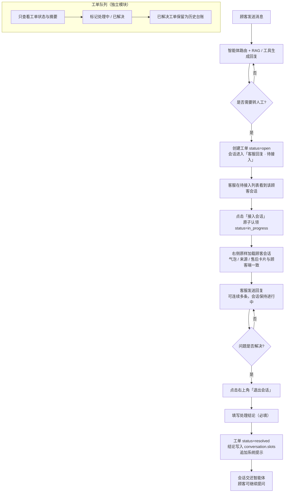

# 客服回复 · 转人工交接流程

工单队列与客服回复是两个独立模块：工单队列只负责查看与标记状态，客服回复负责原样接入顾客会话。
回复不会结束会话；客服确认问题解决后，点右上角「退出会话」并填写结论，才会把会话交还智能体。

## 关键规则

- 接入是独占的：同一会话只有一个客服能回复，第二个接入请求返回 409。
- 回复不结束会话，可以连续发送多条。
- 「退出会话」代表客服确认问题已解决，必须填写处理结论。
- 结论写入 `conversation.slots.last_handoff`，同时追加一条系统提示。
- 交还后智能体继续接待，顾客可以接着提问。
- 工单队列不提供回复框，只保留状态查看与状态标记，避免绕过客服回复流程。
