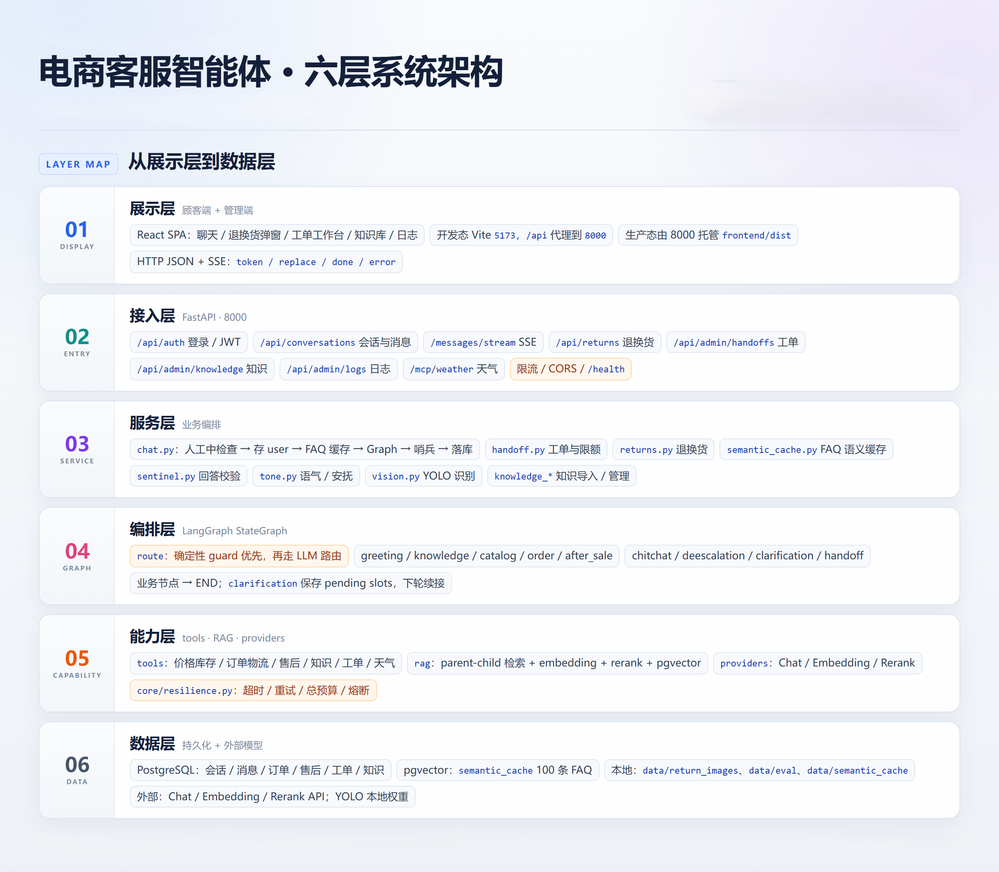

# 电商客服智能体：系统流程与兜底现状

## 一、总览

系统按调用顺序分六层：

1. **展示层**：顾客端和管理端共用 React SPA。开发态由 Vite `5173` 把 `/api` 代理到 `8000`；生产态由 FastAPI `8000` 直接托管 `frontend/dist`。
2. **接入层**：`app/main.py` 和 `app/api/routes/*`，提供登录、会话、消息、SSE、退换货、工单、知识库、日志、天气等 HTTP 接口，并统一处理鉴权、限流、CORS 和 `/health`。
3. **服务层**：`app/services/*`。`chat.py` 负责一轮对话的业务编排；`handoff.py` 管工单，`returns.py` 管退换货，`semantic_cache.py` 管 FAQ 语义缓存，`sentinel.py` 管回答校验，`tone.py` 管语气和安抚，`vision.py` 管 YOLO 识别。
4. **编排层**：`app/graph/*`。LangGraph 先走确定性 guard，再做意图路由，然后进入知识、商品、订单、售后、闲聊、安抚、澄清或转人工节点。
5. **能力层**：`app/tools/*` 提供业务事实，`app/rag/*` 负责检索、向量化、重排，`app/providers/*` 负责 Chat / Embedding / Rerank 调用；`app/core/resilience.py` 统一做超时、重试、总预算和熔断。
6. **数据层**：PostgreSQL 存会话、消息、订单、售后、工单和知识；pgvector 存 FAQ 语义缓存；本地目录存退换货照片、评测集和 FAQ 种子；外部依赖是模型 API 和本地 YOLO 权重。

### 请求主链路

`POST /messages/stream` → 鉴权/限流 → 查询是否处于人工处理中 → 持久化 user 消息 → FAQ 语义缓存 → LangGraph 路由 → 工具 / RAG / 模型 → 哨兵校验 → 持久化 assistant 消息 → SSE 返回 `token / replace / done`。

细小分支：

- 会话处于人工处理中：不进入 Graph，直接返回安抚/人工处理中的回复，并把 user 和 assistant 两条消息都落库。
- FAQ 缓存命中：直接返回缓存答案，不进入 Graph；缓存只覆盖 FAQ 类问题，不缓存订单、售后、价格等动态事实。
- 槽位不完整：`clarification` 节点保存 `pending_intent` 和缺失槽位，下一轮用户补订单号或商品名后继续原意图。
- 流式输出：知识回答先完整缓冲并校验 `[[KNOWLEDGE_GAP]]` 标记，再分块发给前端；最终答案与已发送内容不一致时发 `replace` 事件，前端替换气泡，不追加第二条。

## 二、各层逻辑

| 层 | 主要目录 | 职责 | 关键边界 |
|---|---|---|---|
| 展示层 | `frontend/src` | 顾客聊天、退换货弹窗、工单工作台、知识库和日志页面 | 展示层不拼业务事实，只消费后端返回的答案、来源和售后上下文 |
| 接入层 | `app/main.py`、`app/api/routes` | HTTP/SSE 接口、鉴权、限流、CORS、静态页面托管 | SSE 用心跳保活；流式结束必须有 `done`，否则前端按中断处理 |
| 服务层 | `app/services` | 对话编排、工单、退换货、FAQ 缓存、哨兵、语气、知识导入、YOLO | `run_chat` 是单轮对话的总入口；模型最终失败在这里转成固定话术并落工单 |
| 编排层 | `app/graph` | 意图路由、槽位续接、节点执行、回答生成 | 确定性 guard 优先于 LLM 路由，避免把投诉规则、纯情绪等误判成业务请求 |
| 能力层 | `app/tools`、`app/rag`、`app/providers` | 订单/物流/售后/商品事实、知识检索与重排、模型调用 | 能力层不直接决定对外话术；异常由编排层统一降级 |
| 数据层 | `app/db`、PostgreSQL、pgvector | 会话、消息、业务数据、工单、知识、缓存、图片 | 动态事实以数据库为准；FAQ 缓存只是加速，不替代业务查询 |

## 三、三类兜底

### 1. 模型失败：自动重试

**结论：非流式已完整覆盖；流式首 token 前可重试，已出 token 后走非流式重生成 + `replace`。**

已有机制：

- `chat.complete`、Embedding、Rerank 都走 `execute_with_resilience`。
- 默认重试 2 次，即最多 3 次尝试；每次重试前固定等待 0.5 秒。
- 可重试异常：`timeout`、`connection`、`rate_limit`。
- 不重试异常：`authentication`、`invalid_request`、`quota_exceeded`、`budget_exceeded`、`circuit_open`。
- 单个 provider 连续 3 次最终失败后熔断 30 秒；熔断期内直接抛 `ProviderCircuitOpenError`。

默认预算：

| 调用 | 单次超时 | 总预算 | 自动重试 |
|---|---:|---:|---|
| `chat.complete` | 30s | 60s | 2 次 |
| Embedding | 20s | 60s | 2 次 |
| Rerank | 15s | 30s | 2 次 |
| `chat.stream` | 30s 空闲超时 | 60s | 首 token 前 2 次；已出 token 后不续写 |

边界：

- 流式首 token 前失败按统一策略重试；一旦已经输出 token，不在原流上续写。
- 已出 token 后失败改为非流式重生成完整答案，再用 `replace` 覆盖气泡；不做 token 级拼接或跨 provider 续写。
- 开关 `STREAM_RETRY_ENABLED` 默认开启，可按环境关闭回滚。

最终失败时，`run_chat` 捕获 `ProviderError` 或回合总预算超时，返回 `PROVIDER_FAILURE_ANSWER`，写入 `provider_failure` 证据并转人工工单。

### 2. tool 故障：服务降级

**结论：有基础降级，没有备用数据源。**

已有降级路径：

| 故障点 | 当前处理 | 对外结果 |
|---|---|---|
| 知识检索抛异常 | `_knowledge_unavailable(status="retrieval_failed")` | `knowledge_gap`、安全话术、工单 |
| 知识无结果 | `status="not_found"` | 同上 |
| 知识上下文不足 | `status="insufficient_context"` | 同上 |
| 知识回答为空 | `status="empty_answer"` | 同上 |
| 商品价格/库存工具异常 | `catalog_node` 捕获 | `KNOWLEDGE_GAP_REPLY` + `handoff` |
| 订单/物流工具异常 | `order_node` 捕获 | `KNOWLEDGE_GAP_REPLY` + `handoff` |
| 售后查询异常 | `status="query_error"` | `KNOWLEDGE_GAP_REPLY` + `handoff` |
| 售后无记录 | `status="no_records"` | 正常说明“暂未查询到售后记录” |
| 售后订单不可用 | `status="not_available"` | 提示核对订单号，不伪造售后状态 |
| FAQ 缓存异常 | `lookup` 捕获后返回已有命中或 `None` | 跳过缓存，继续主链路 |
| 哨兵调用超时/异常/JSON 非法 | `check_answer` 返回未检查 | fail open，不拦截正常回答 |
| 天气工具异常 | `chit_chat` 捕获 | 返回天气暂不可用，不影响其他业务 |

统一原则：工具失败不硬编事实，不把内部错误分类暴露给顾客；降级到安全话术、知识缺口或人工工单，并保留 `tool_evidence` 便于审计。

仍缺的机制：

- **没有备用数据源。** 商品、订单、售后工具异常时不会切到只读副本、缓存快照或静态 FAQ。
- **工具级保护没有全覆盖。** 订单只读 FC 已接入 runtime 的超时、重试、熔断；商品、售后、知识等确定性节点仍是异常后直接降级，尚未共用同一套策略。
- **没有分层降级。** 当前只有“正常返回”与“安全话术 + 人工”两级，没有“降级到简化答案后继续自助”的中间层。

### 3. 任务中断：断点回复

**结论：暂无。**

不存在的机制：

- 没有 checkpoint。
- 没有断点续跑。
- 没有自动续答。
- 没有“同一轮请求失败后从已生成位置继续”的恢复逻辑。

现有的只是中断前后的保护：

- SSE 每 15 秒发心跳，避免网关把长连接判死。
- 知识回答先完整缓冲并校验，再分块输出，避免先吐半截再被固定话术覆盖。
- 流式结果与最终结果不一致时发 `replace`，前端替换气泡。
- 前端 `sendMessageStream` 在连接结束但没有收到 `done` 时抛出“流式响应中断，请重试”；`CustomerApp` 回拉一次历史消息，由用户重新发送。
- 澄清阶段的槽位续接（补订单号、商品名）只恢复原意图，不是任务中断后的断点回复。

连接断开时，后端会取消当前流式任务；没有把未完成回合写入可恢复的 checkpoint，因此不会自动接着生成。

## 四、结论

| 能力 | 现状     | 关键缺口 |
|---|--------|---|
| 模型失败自动重试 | 已覆盖    | 不做 token 级续写；缺少真实故障演练与指标观察 |
| tool 故障服务降级 | 部分覆盖  | 确定性节点未接入统一 runtime、无备用数据源、RAG 无三级降级、无中间层降级 |
| 任务中断断点回复 | **暂无** | 无 checkpoint、无断点续跑、无自动续答 |

## 五、计划

1. **模型失败：自动重试**
在现有非流式重试、流式首 token 前重试的基础上，补齐真实故障演练与指标观察。
2. **tool 故障：服务降级**
确定性节点接入统一 runtime；检索按 `rerank → 向量 → FAQ / 关键词` 逐级降级；仍失败走安全话术 + 工单，并补备用数据源。
3. **任务中断：断点回复**
回合级 checkpoint + 幂等键，支持断点续跑与事件回放，前端按最后事件恢复。
